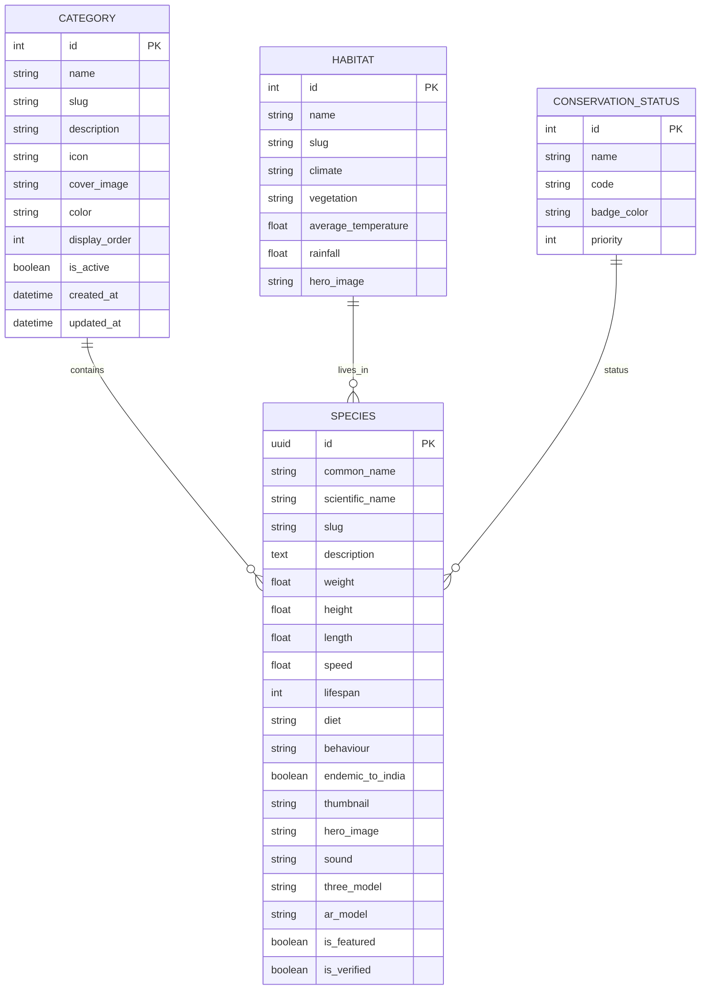
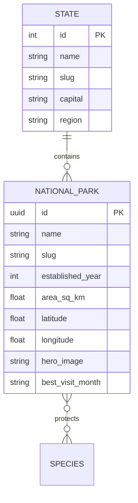
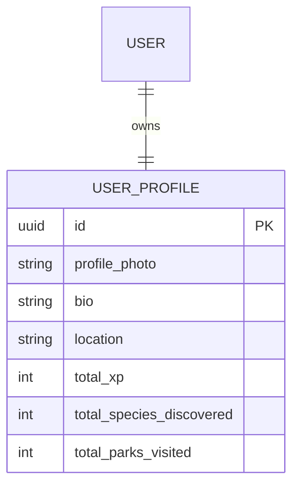
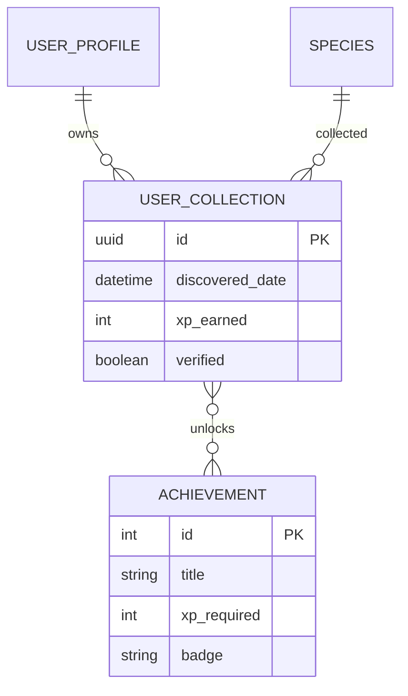
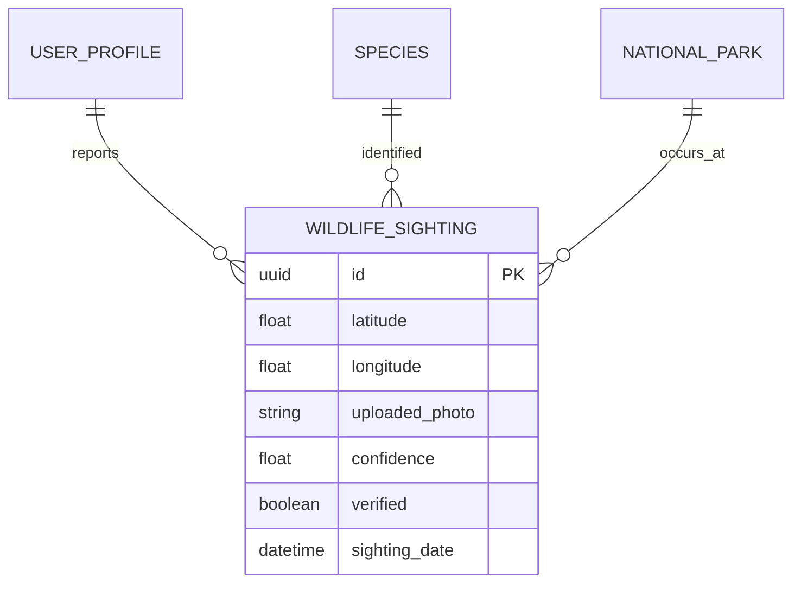
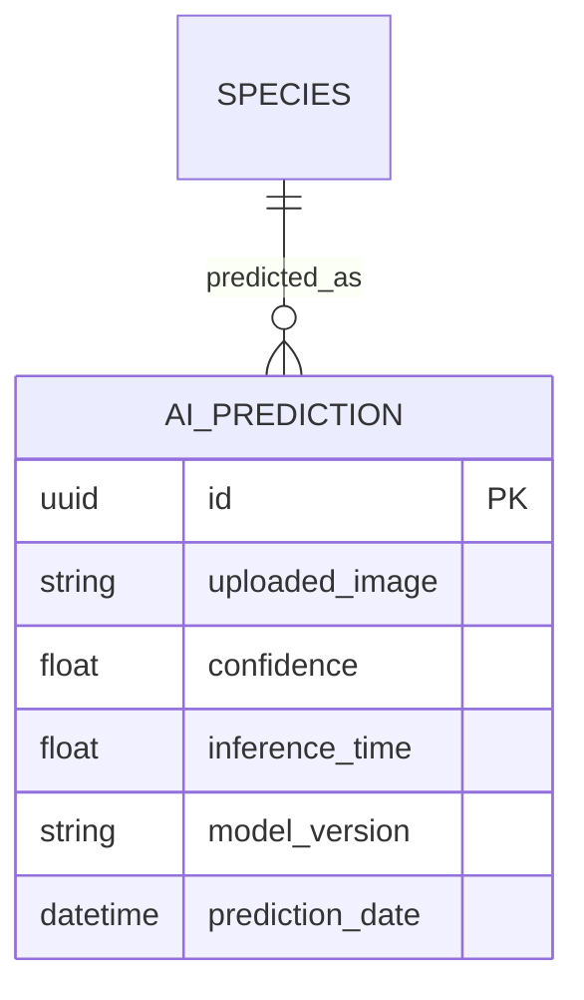
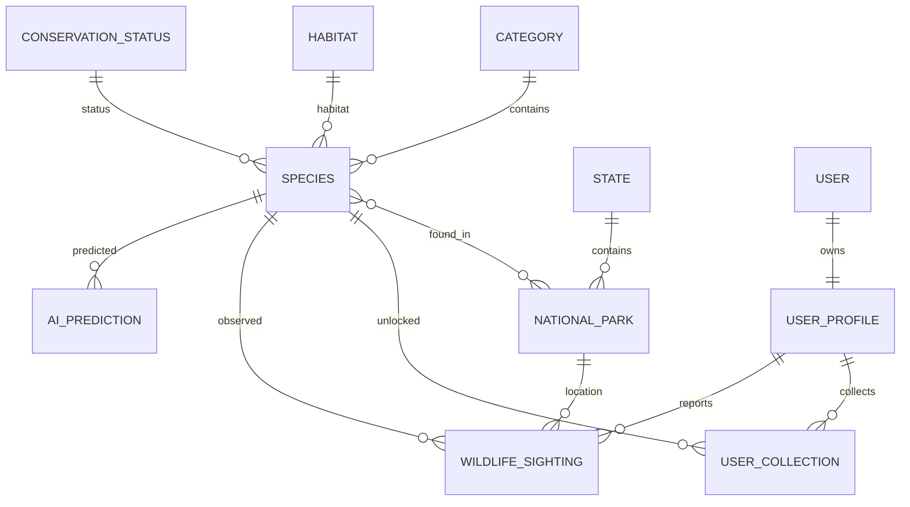

# 🌿 WildFIndia - Database Entity Relationship Diagram (ERD)

## Overview

WildFIndia is a full-stack wildlife conservation and exploration platform featuring:

- Wildlife Information
- AI Species Identification
- National Parks
- Citizen Science
- WildDex (Gamification)
- Interactive Maps
- Three.js Visualization

---

# Wildlife Module

---

# Parks Module

---

# Accounts Module

---

# WildDex Module

---

# Sightings Module

---

# AI Identifier Module

---

# Complete Database Overview

---

# Legend

| Symbol | Meaning |
|---------|----------|
| `||` | Exactly One |
| `o{` | Zero or Many |
| `}|` | One or Many |
| `}o--o{` | Many-to-Many |

---

# Status

- ✅ Database Planning
- ✅ ER Diagram
- ⏳ Django Models
- ⏳ Admin Panel
- ⏳ Migrations
- ⏳ Sample Data
- ⏳ REST API
- ⏳ AI Integration