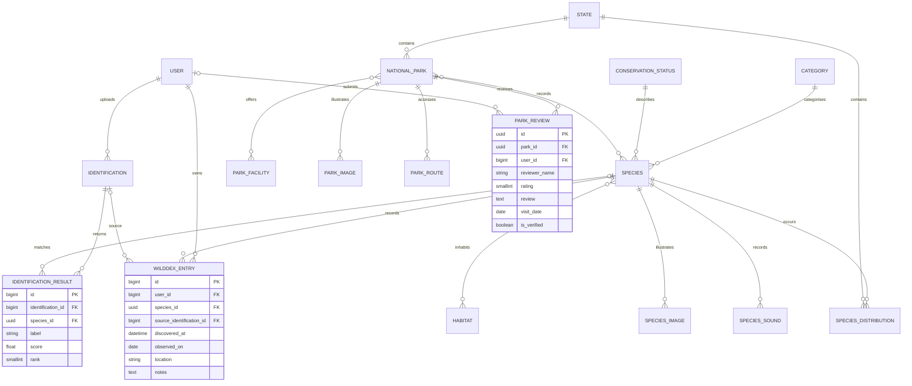

# WildFIndia database relationships

This diagram describes the implemented application. Django's built-in User
model owns private identification history and journal entries. Wildlife and
protected-area records form the public catalogue.

- A user can have one WildDex entry per species. XP is calculated from entries,
  so confirming the same species twice does not award extra XP.
- A user can submit one review per park. Reviews remain private until moderated.
- Deleting an identification leaves the WildDex entry and clears its source link.
- A prediction may have no matching species in the curated catalogue.
- A species/state combination has one distribution record.
- A protected area's name, state and type together identify its directory record.
- Catalogue photos downloaded for the project are static assets. Their source
  metadata is in `datasets/catalogue_media.json`; user/admin uploads use the
  relevant database image fields.
